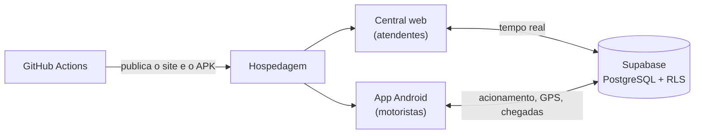

# Sistema Monstros — gestão para empresas de reboque

Plataforma criada por **João Victor Moraes** para a **Monstros Reboque**: central de operação na web, aplicativo
Android para os motoristas, mapa ao vivo e checklist dos caminhões. Está em produção desde outubro de 2026 e é
usada todos os dias pelos atendentes e motoristas da empresa.

> **Esta é a vitrine do projeto.** O código é privado, porque o sistema está em produção e com dados reais.
> As telas abaixo são de uma demonstração com **dados fictícios**.

## O que o sistema faz

### Central de operação (web)
- Lançamento dos atendimentos: motorista, protocolo, placas, seguradora, canal, origem e destino.
- Detalhes de cada atendimento: uso de patins, atraso, valor negociado e observações.
- Acompanhamento por status (em rota, chegou na origem, finalizado) e previsão de término com alerta de atraso.
- Comissões por motorista, fechamento de quinzena e relatórios em Excel.
- Busca e atalhos (hoje, turno atual, última hora, quinzena, atrasados).
- Tudo em tempo real: o que um atendente lança aparece na hora para os outros, sem atualizar a página.

### Acionamento do motorista
Ao salvar um atendimento, o motorista que está com o app aberto recebe o acionamento na hora, com alarme,
e tem 1 minuto para aceitar. A central vê se ele aceitou, recusou ou não respondeu.

### Aplicativo Android do motorista
- Alarme de acionamento que abre por cima de outros apps e da tela bloqueada.
- Rastreamento GPS em segundo plano, mesmo com o app fechado (serviço nativo).
- Chegada na origem e no destino, checklist do caminhão e registro de abastecimento pelo celular.
- Atualização do app pelo próprio app, sem passar pela loja.

### Motoristas ao vivo, mapa e despacho

### Checklist dos caminhões
Check-in e check-out de cada turno com fotos e vídeos, controle de quilometragem, abastecimento com foto da
bomba e consumo médio real de cada caminhão.

### Mensagens prontas para o WhatsApp
Posição do guincho, previsão de liberação e bairros próximos, formatadas para os grupos.

### Preparado para várias empresas
Cada empresa vê só os próprios dados (Row Level Security no PostgreSQL), tem os próprios usuários
(administrador, atendente e motorista) e a própria identidade visual (logo, cores, fundo e letras).

### Em implantação
- **Meu Reboque:** link para o cliente acompanhar o guincho ao vivo, ver as etapas e falar com a central,
  sem que o número do motorista apareça.
- **Acesso para associados:** login para o cliente da associação acompanhar os reboques dos próprios veículos.

## Tecnologias

| Parte | Tecnologia |
|---|---|
| Central web | JavaScript, HTML e CSS (página única, funciona também offline) |
| Banco e back-end | Supabase: PostgreSQL com Row Level Security, funções no banco, Realtime e Storage |
| Funções no servidor | Supabase Edge Functions (TypeScript / Deno) |
| App Android | Capacitor + plugins nativos em Java (GPS em segundo plano, alarme, atualização) |
| Mapas | Leaflet + OpenStreetMap |
| Relatórios | ExcelJS |
| Publicação | GitHub Actions: publica o site sozinho e gera o APK assinado a cada mudança |

## Como as partes se conectam

## Autor

**João Victor Moraes** — desenvolvedor de software com foco em sistemas de baixo nível, engenharia reversa
e segurança da informação.

Quer ver uma demonstração ao vivo? Entre em contato pelo meu perfil.

Projeto criado para a Monstros Reboque. Todos os direitos reservados.
